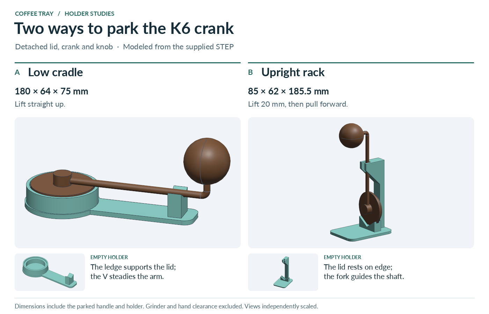

# Coffee gear tray

Model each object as it sits in storage, one at a time. The equipment models represent the real objects. Tray pockets, finger access and room to lift pieces out come later.

**Footprint rule for all holders:** minimize the tray area each holder adds beyond the parked item. Compare layouts with the gear in place, including overhangs. Preserve stable support and a clear path for fingers and removal; a smaller printed base is not a saving if the same space must stay empty.

| Order | Reference item | Status |
| --- | --- | --- |
| 1 | [Small scale](../equipment/coffee/scale.md) | Simplified reference built; stores on 148.4 mm body edge |
| 2 | [Stack of V60 filter papers](../equipment/coffee/v60_filters.md) | Measured quarter-circle stack modeled; holder orientation open |
| 3 | [Manual WDT tool](../equipment/coffee/wdt.md) | Grip and needle reach modeled; [open-collar hanger](concepts/wdt_open_collar.svg) selected; relaxed needle spread unmeasured |
| 4 | [Normcore V4 tamper cap](../equipment/coffee/normcore_tamper_cap.md) | Cap exterior modeled; the cap, not the 58.5 mm tamper base, locates in the tray |
| 5 | [Dosing ring](../equipment/coffee/dosing_ring.md) | Straight ring modeled, including its through bore |
| 6 | [Gaggia bottomless portafilter](../equipment/coffee/gaggia_portafilter.md) | Measured drop at neck and grip; raised handle-forward and handle-rearward poses |
| 7 | [KINGrinder K6, lid/crank and knob](../equipment/coffee/kingrinder_k6.md) | [Option B: upright rack](#detached-k6-handle-parking) selected, with a lower-profile holder to explore in the full mockup; park separately if space permits |

The scale stands on its long edge. Start a width test coupon at **24.5 mm** (23.5 mm measured thickness + 0.5 mm clearance per face), not a press fit. This is a trial CAD opening, not a guaranteed as-printed size. Print the coupon with the tray's material, orientation and settings; check that the scale drops in and lifts out without dragging its four load-cell feet. Adjust the tray allowance from the coupon, not the scale model.

## WDT hanger decision

Use a single straight post rising from the tray and a rigid C-shaped conical collar, open opposite the post. The seat is wider at the top: the tapered handle hangs by gravity and is intended to self-align. Store the tool needles down without loading the tips. For removal, lift the grip clear of the rim and slide the needles sideways through the opening. This replaces the earlier [cup sketch](concepts/wdt_dock.svg).

**Defer holder refinement until the full equipment mockup exists.** At that point measure the relaxed needle spread, size the slot to pass it without flexing the needles while retaining the grip, and verify that the handle releases without wedging. Set the post height, tip clearance, edge rounding and exit direction against the tray and neighboring gear. The open sides do not shield the needles, so keep them inside the tray perimeter and out of normal hand paths. The sketch is not a dimensioned or print-ready part.

## Reversible portafilter station

One seat, two placements: handle toward the user for tamping, toward the wall for storage. The basket stays upright and on the same centerline. Lift, turn 180° and reseat; this does not require clearance for a horizontal sweep while seated. Run `cad run -m coffee_tray.portafilter_poses` from `src/` to inspect the two alternatives.

The black grip hangs 18 mm below the portafilter head. For both mockup poses, the **head underside is 20 mm above the local tray deck**: 18 mm measured drop plus a provisional 2 mm air gap. At 18 mm it would just touch. This is a placement requirement over a flat deck, not a finished holder height. The metal neck also passes below the basket, so relieve its path on both sides. Recheck against any raised lip or adjacent item and under tamping load when refining the station.

Reserve opposing handle/neck openings and clear the ears in both poses. The design intent is to keep the basket rim level under tamping force and support the rigid metal head directly over the base, not the plastic grip or perforated basket floor. Confirm a usable metal contact surface on the real part. Reserve center-to-wall reach plus hand/placement clearance for storage; the present model reaches 180 mm behind center. Check rear wall, front overhang, adjacent gear, basket underside clearance, skid/tip resistance and loaded stability at refinement. No station geometry or load rating has been set.

## Detached K6 handle parking

**Decision: Option B, with a lower-profile holder.** Keep the lid on edge and the crank upright. In the full mockup, try a shorter arm guide and use the tray deck instead of a broad standalone base wherever it can provide the same stability. Lowering the guide alone does not lower the parked knob. Final holder dimensions are deferred; the image and measurements below document the original comparison, not a revised design.

Both concepts use the unmodified handle STEP, including the lid and knob. The bounds below are axis-aligned (length × width × height in mm); they exclude the grinder, fingers and the removal path.

| Concept | Empty holder | With handle parked | How it works |
| --- | --- | --- | --- |
| Low cradle | 150 × 64 × 25.52 | 180 × 64 × 74.95 | The lid flange rests on an annular ledge above its center pin. A shallow V under the far end of the arm keeps the knob aligned. Lift straight up. The knob reaches 30 mm beyond the base. |
| Upright rack | 85 × 62 × 116 | 85 × 62 × 185.50 | The lid stands on edge in a shallow V between guide cheeks. An open fork steadies the arm; lift the lid, then draw the crank forward out of the fork. No snap fit. |

The original upright rack's occupied bounding rectangle is 54% smaller than the low cradle's. Its modeled 20 mm lift needs 205.5 mm above the deck, plus hand clearance and an unobstructed front exit. Recheck stability and removal with the shorter guide once all seven items are placed. Keep separate parking conditional on that layout; the low cradle is a fallback if headroom or access rules out the upright pose.

Build from `src/` with `cad run -m coffee_tray.k6_handle_docks`. With the local reference STEP present, run `cad run -m coffee_tray.check_k6_handle_docks` for the geometry checks. Both parked assemblies touch their holders without solid overlap. The low lift (35 mm) and the upright lift (20 mm) followed by a forward pull (80 mm) were checked at 1 mm increments against each holder alone. These are example release paths, not minimum necessary travel or a continuous sweep proof.

Where the lid is guided, the nominal side allowance is 0.8 mm per side. The upright fork has a 7.6 mm clear opening for the 6 mm shaft. The first-pass FDM check (base down, PETG, 0.4 mm nozzle, 0.2 mm layers) flagged neither holder for supports; this is not a slicer or stability test. Tune allowance and edge treatment with a coupon and check knock-over risk, comfort and nearby gear after the complete layout is available.
