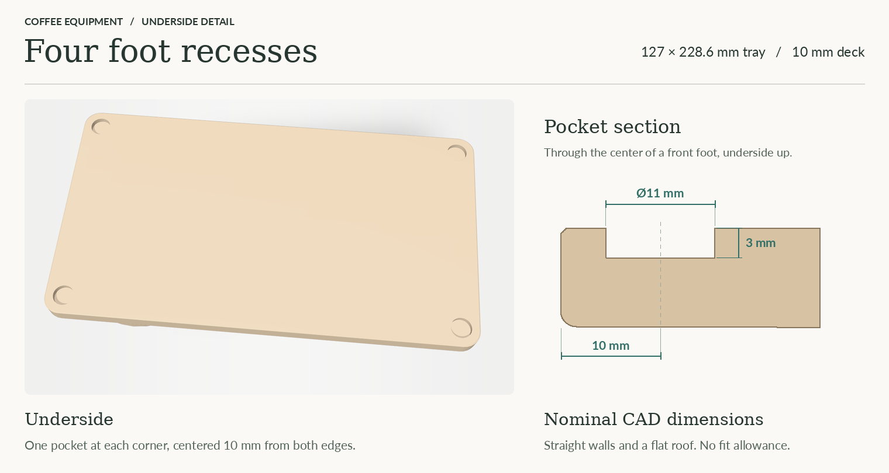
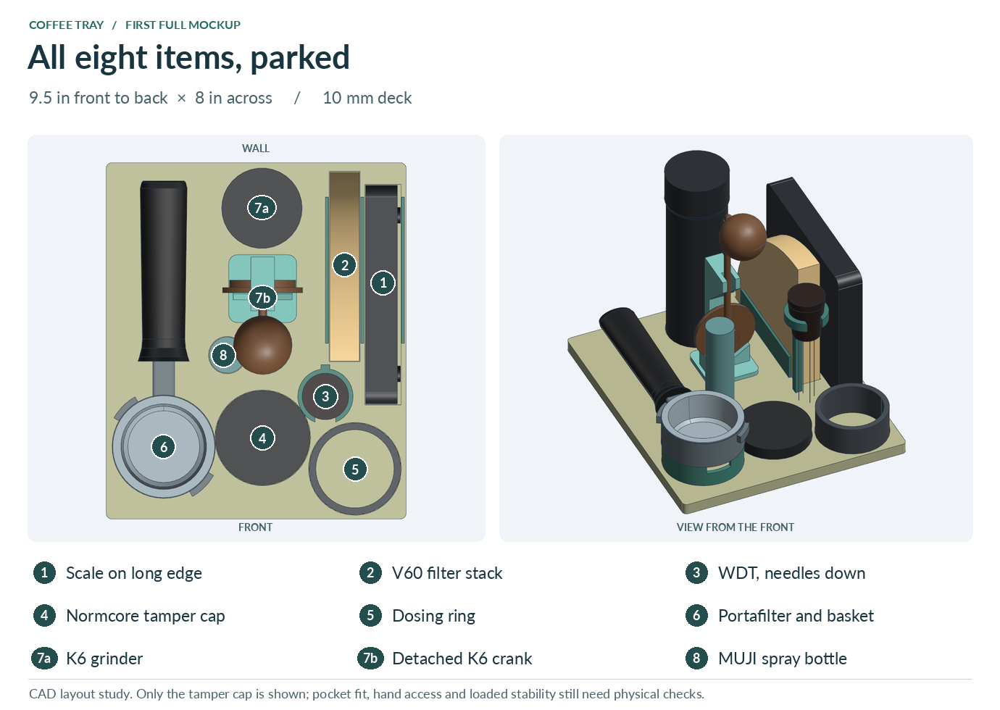

# Coffee gear tray

The current tray holds four items: portafilter, WDT, scale and V60 filters. The earlier eight-item layout and all equipment references are retained for comparison.

**Footprint rule for all holders:** minimize the tray area each holder adds beyond the parked item. Compare layouts with the gear in place, including overhangs. Preserve stable support and a clear path for fingers and removal; a smaller printed base is not a saving if the same space must stay empty.

## Compact four-tool tray

The [compact study](compact.py) measures **5 in across × 9 in front to back** (127 × 228.6 mm) and retains the **10 mm base**. It is 3 in narrower and 0.5 in shallower than the eight-item tray, about 41% less counter area. The grinder, crank, bottle, dosing ring and tamper cap have no holders or pockets in this version.

**Underside feet.** Four flat-bottomed recesses are exactly Ø11 mm × 3 mm deep in CAD, with no fit allowance, taper or entrance chamfer. Each center is 10 mm from its two adjoining nominal edges; spacing is 107 × 208.6 mm center to center. The 10 mm deck leaves 7 mm above the recesses except where the rear-right one overlaps the scale slot, where 2.5 mm of material remains. The pockets do not break through.

**Filled portafilter pedestal.** A shallow pocket replaces the open ring. The [pedestal](portafilter_station.py) stands 20 mm above the deck, with 14 mm beneath the center of the pocket and 6 mm free directly beneath the modeled basket. A 3 mm base fillet blends into the deck, a 2.3 mm fillet rounds the pocket floor, and 1.25 mm outer and 1.1 mm inner lip radii preserve two flat metal-head bearing lands. Opposing neck cutouts have 3.5 mm lower and 1.5 mm upper radii. See [the seating check](#reversible-portafilter-station) before applying tamping force.

**Paper and scale fins.** Both tall paper walls, including the shared divider, are 3.2 mm thick; the low outer scale guide is 3.0 mm. Their exposed deck junctions use 3, 1.25 and 1.5 mm root fillets respectively. The equipment lift corridors remain clear: 21 mm across for paper, 24.5 mm for the scale.

**Integrated WDT cape.** A flared, open-front shell replaces the straight post and unsupported collar. Its curved shoulders carry the tapered tool; a 2 mm internal root fillet joins the hem to the deck. The C-shaped seat retains its front release. The paper-pocket lips have 0.55 mm fillets and the WDT rim has a 0.6 mm fillet. The deck retains its 0.6 mm lower chamfer and 1.6 mm upper round-over.

[Download the flat-bed prototype STL and print notes](prints/compact-four-tool-tray.zip). The print body is one solid, 127 × 228.6 × 109 mm, with its bottom at Z=0. See [print checks and assumptions](prints/PRINT-NOTES.md) before printing; no physical load or fit test is implied.

The portafilter seat and open WDT collar share one front centerline. The handle parks along the open left side. On the right, the papers and scale stand on edge against one shared divider, with their rear edges aligned. The longer scale extends 20.4 mm farther forward than the paper stack, leaving its end exposed. The low outer scale guide, rounded deck edge and warm-stone preview color are unchanged.

**Deep V60 pocket:** Thin stacks can lean against either side. The two paper walls now rise to 80 and 86 mm above the deck, up from 16 and 25 mm, without widening the 21 mm opening. The deck recess stays 4.5 mm deep. The near wall dips to 46 mm at the finger scoop so a small packet can be pinched from the side, and low end stops keep the papers from sliding lengthwise. The 1 mm packet is an illustrative near-empty condition, not a measured sheet thickness.

The nominal holder allowances are 0.5 mm per face and the file slots are 4.5 mm deep, leaving 5.5 mm of deck below. The WDT hangs needles down, with the collar open toward the user. The portafilter keeps its two-way 20 mm head support. Its parked tip is 5.6 mm inside the rear edge; in the tamping pose it extends 137 mm (5.39 in) beyond the front. The deck itself never moves or changes size.

Build from `src/` with `cad run -m coffee_tray.compact` (empty, bed-ready print body, full stack, nearly empty, and tamping views) and check with `cad run -m coffee_tray.check_compact`. Modules keep features editable, but the displayed tray and bed-ready export fuse them. The checks cover both seated poses, the paper lift corridor with a near-empty and full stack, and the front WDT release. Paper flex, actual needle spread, hand access, print fit and stability under tamping load still require physical checks.

## Earlier eight-item layout

The [working mockup](layout.py) uses a **9.5 × 8 in (241.3 × 203.2 mm) footprint and a 10 mm deck**. In this version the long side runs toward the wall. The 10 mm is the base thickness before pockets, not a height limit on holders or gear.

The raised, reversible portafilter seat is at the front left. The tamper cap and dosing ring sit at the front; scale and papers stand on edge along the right side, sharing a divider. The grinder and detached crank park separately. A **46 × 46 mm base and 102 mm guide** replace Option B's original 85 × 62 mm base and 116 mm guide; the knob still sets the assembly height at 185.5 mm above the deck (195.5 mm above the counter). The bottle sits between the portafilter and crank, clear of both in the parked model.

**The footprint is met in storage, not while tamping.** The basket center is 49 mm behind the front edge. Its modeled 180 mm handle reach puts the parked tip 12.3 mm inside the rear edge and the forward tip 131 mm (5.16 in) past the front edge. This is a temporary equipment overhang, not extra tray material. Both opposite tips cannot fit inside this rectangle with a single fixed seat, even diagonally: their separation is 360 mm versus a 315.5 mm deck diagonal. If no overhang is acceptable, revisit the one-seat requirement before refining the layout.

Round pockets are 2.5 mm deep; file slots are 4.5 mm deep, leaving at least 5.5 mm of floor. The starting allowance is 0.5 mm per side, not a validated print fit. The WDT hangs with 5 mm nominal tip clearance. Nozzle settings, printed tolerances, needle spread, one-handed access, tall-item stability and the metal bearing surface under tamping force still need verification. Only the measured tamper **cap** is modeled: the tamper above it must be checked for overhang and hand access.

Build from `src/` with `cad run -m coffee_tray.layout`, then run `cad run -m coffee_tray.check_layout`. The checker compares solids between the equipment, supports and deck and tests the footprint in both seated poses, not the swing from one to the other. Lift and reseat the portafilter. The compact crank rack's 8 mm lift followed by a 45 mm forward slide was sampled every 1 mm against its holder alone (`coffee_tray.check_k6_handle_docks`). These are layout studies, not a load-rated or print-ready assembly.

## Equipment references

| Order | Reference item | Status |
| --- | --- | --- |
| 1 | [Small scale](../equipment/coffee/scale.md) | Simplified reference built; stores on 148.4 mm body edge |
| 2 | [Stack of V60 filter papers](../equipment/coffee/v60_filters.md) | Measured quarter-circle stack modeled; holder orientation open |
| 3 | [Manual WDT tool](../equipment/coffee/wdt.md) | Grip and needle reach modeled; [open-collar hanger](concepts/wdt_open_collar.svg) selected; relaxed needle spread unmeasured |
| 4 | [Normcore V4 tamper cap](../equipment/coffee/normcore_tamper_cap.md) | Cap exterior modeled; the cap, not the 58.5 mm tamper base, locates in the tray |
| 5 | [Dosing ring](../equipment/coffee/dosing_ring.md) | Straight ring modeled, including its through bore |
| 6 | [Gaggia bottomless portafilter](../equipment/coffee/gaggia_portafilter.md) | Measured drop at neck and grip; raised handle-forward and handle-rearward poses |
| 7 | [KINGrinder K6, lid/crank and knob](../equipment/coffee/kingrinder_k6.md) | Separate upright parking fits in the first layout; compact version of [Option B](#detached-k6-handle-parking) |
| 8 | [Small MUJI spray bottle](../equipment/coffee/muji_spray_bottle.md) | Upright cylindrical reference, Ø24.40 × 86 mm; holder depth and clearance deferred |

The scale stands on its long edge. Start a width test coupon at **24.5 mm** (23.5 mm measured thickness + 0.5 mm clearance per face), not a press fit. This is a trial CAD opening, not a guaranteed as-printed size. Print the coupon with the tray's material, orientation and settings; check that the scale drops in and lifts out without dragging its four load-cell feet. Adjust the tray allowance from the coupon, not the scale model.

## WDT hanger decision

For the active compact tray, retain the gravity-seated conical collar and needles-down storage but replace the cantilevered post with the [open cape](wdt_cape.py). The seat is wider at the top; lift the grip clear of the rim, then slide forward through the opening. The [straight-post study](concepts/wdt_open_collar.svg) and [earlier cup sketch](concepts/wdt_dock.svg) are historical alternatives.

Before printing, measure the relaxed needle spread and allow clearance relative to the checked 16 mm exit gauge. Do not force a wider bundle through. Verify easy release and tip clearance on the physical print; the open face is not a guard against touching the needles.

## Reversible portafilter station

One seat, two placements: handle toward the user for tamping, toward the wall for storage. The basket stays upright and on the same centerline. Lift, turn 180° and reseat; this does not require clearance for a horizontal sweep while seated. Run `cad run -m coffee_tray.portafilter_poses` from `src/` to inspect the two alternatives.

The black grip hangs 18 mm below the portafilter head. In both poses on the compact tray the head sits 20 mm above the deck and contacts two flat lands totaling 476.5 mm² in the model. The closest basket-to-tray distance is 4.29 mm, versus 6 mm vertically at the center. The metal neck clears by 2.00 mm in both directions. The grip clears the complete tray by 2.00 mm in storage and 15.19 mm pointing forward, where its low point is beyond the front edge.

The underside of the installed basket is provisionally flush with the metal bearing face. Measure the actual basket projection below that face, and check on the print that both sides of the metal head sit flat without the basket, neck or grip bearing weight. The modeled contact area is not a physical measurement or a load rating. Check for rocking or sliding before tamping, and reserve the modeled 180 mm center-to-tip reach plus hand clearance at the wall.

## Detached K6 handle parking

**Decision for the eight-item layout: Option B, with a lower-profile holder.** Keep the lid on edge and the crank upright. The [eight-item layout](#earlier-eight-item-layout) trials a shorter arm guide and smaller base. Lowering the guide alone does not lower the parked knob. The image and measurements below document the original comparison, not the revised rack.

Both concepts use the unmodified handle STEP, including the lid and knob. The bounds below are axis-aligned (length × width × height in mm); they exclude the grinder, fingers and the removal path.

| Concept | Empty holder | With handle parked | How it works |
| --- | --- | --- | --- |
| Low cradle | 150 × 64 × 25.52 | 180 × 64 × 74.95 | The lid flange rests on an annular ledge above its center pin. A shallow V under the far end of the arm keeps the knob aligned. Lift straight up. The knob reaches 30 mm beyond the base. |
| Upright rack | 85 × 62 × 116 | 85 × 62 × 185.50 | The lid stands on edge in a shallow V between guide cheeks. An open fork steadies the arm; lift the lid, then draw the crank forward out of the fork. No snap fit. |

The original upright rack's occupied bounding rectangle is 54% smaller than the low cradle's. Its modeled 20 mm lift needs 205.5 mm above the deck, plus hand clearance and an unobstructed front exit. Recheck stability and removal with the shorter guide once all equipment is placed. Keep separate parking conditional on that layout; the low cradle is a fallback if headroom or access rules out the upright pose.

Build from `src/` with `cad run -m coffee_tray.k6_handle_docks`. With the local reference STEP present, run `cad run -m coffee_tray.check_k6_handle_docks` for the geometry checks. Both parked assemblies touch their holders without solid overlap. The low lift (35 mm) and the upright lift (20 mm) followed by a forward pull (80 mm) were checked at 1 mm increments against each holder alone. These are example release paths, not minimum necessary travel or a continuous sweep proof.

Where the lid is guided, the nominal side allowance is 0.8 mm per side. The upright fork has a 7.6 mm clear opening for the 6 mm shaft. The first-pass FDM check (base down, PETG, 0.4 mm nozzle, 0.2 mm layers) flagged neither holder for supports; this is not a slicer or stability test. Tune allowance and edge treatment with a coupon and check knock-over risk, comfort and nearby gear after the complete layout is available.
